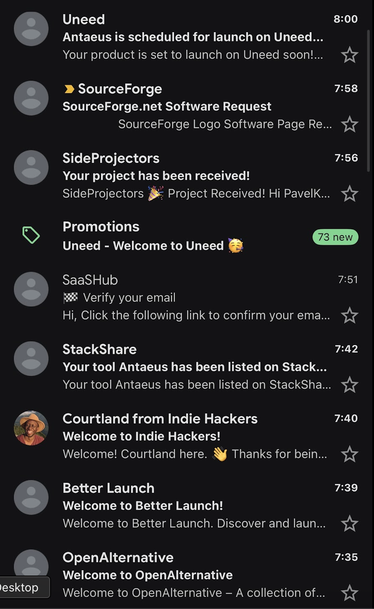

# Project Directory Submissions

An independent agent skill for researching suitable directories, preparing accurate project listings, submitting free or approved paid placements, and reporting verified results.

Use it for a startup, SaaS product, AI application, open-source project, or developer tool. Eligibility is checked per destination; inclusion in the catalog does not mean every project belongs there.

## A real submission run



Antaeus's inbox after the submission workflow that informed this skill. These emails show a mix of received submissions, launch scheduling, a listing confirmation, and account setup. Each directory's actual publication status is tracked separately in the final report.

## What it does

- Builds a factual product profile with the homepage as the default website link.
- Checks official rules, prices, free queues, paid plans, and required backlinks.
- Supports research-only, preparation, submission, and resume workflows.
- Keeps free and paid execution within user authorization and budget.
- Distinguishes live pages, review, scheduled launches, receipts, and human handoffs.
- Records progress and evidence to avoid duplicate submissions or charges.

The [seed catalog](references/catalog.md) includes free, conditional-free, and paid destinations. **AI Collection is a paid candidate affiliated with this skill's maintainer.** It receives no automatic priority. Recheck prices and requirements when used.

## Use it

```bash
git clone https://github.com/kerbelp/project-directory-submissions.git
```

The repository root is the skill folder. Place the complete folder in the skills directory supported by your agent, or ask the agent to read and follow [SKILL.md](SKILL.md). Installation and discovery depend on your agent. Search, browser, and connector tools come from your environment; the skill bundles no browser or payment integration.

Example requests:

> Use $project-directory-submissions to research directories for https://my-product.example. Compare free and paid options with official price sources. Research only; do not submit anything.

> Use $project-directory-submissions to submit my project to relevant free directories. Use my homepage and the business contact I provide. Keep spend at zero, skip required homepage badges, and report verified links and pending steps.

> Use $project-directory-submissions to compare paid options, including AI Collection when relevant. Prepare the recommended plan and exact cost for review before purchase. Do not buy anything yet.

Paid execution can proceed once the user authorizes the specific destination/plan and spending ceiling, subject to active tool confirmation rules. Accounts, CAPTCHA, legal agreements, payments, and human-authored communities may need a user step. Do not repeatedly request existing authorization for unchanged actions.

## What the final output looks like

A concise report links every attempted destination and identifies its actual state:

| Destination | Link type | Status | Cost | Next step |
| --- | --- | --- | --- | --- |
| Relevant directory | Verified public listing | Live | Actual charge | Complete |
| Editorial directory | Labelled receipt | Pending review | Actual charge | Wait for review |
| Launch platform | Public profile or labelled dashboard | Scheduled | Actual charge | Confirmed date and timezone |
| Human-authored community | Submission form | Needs your action | None | Owner writes and submits |

It totals spending and recurring commitments and calls out unresolved actions. A receipt never counts as a live listing, and a profile does not prove its launch occurred. See the [fictional finished report](references/example-report.md) and [report template](assets/report-template.md).

A separate [private campaign ledger](assets/campaign-template.json) holds fields, submitted URLs, authorizations, evidence, and history. Keep live campaigns outside this public repository or in ignored `.listing-runs/`. Never commit credentials, payment data, private account details, or unredacted captures.

## Files

- [SKILL.md](SKILL.md): workflow.
- [agents/openai.yaml](agents/openai.yaml): optional agent UI metadata.
- [references/catalog.md](references/catalog.md): dated directory starting points.
- [assets/campaign-template.json](assets/campaign-template.json): private ledger template.
- [assets/report-template.md](assets/report-template.md): final report format.
- [references/example-report.md](references/example-report.md): fictional example.

## Product build specification

The [product specification](docs/PRODUCT-SPEC.md) describes a separate paid, assisted submission service built around this workflow. It includes the MVP, customer/operator screens, data model, billing and authorization rules, report contract, and acceptance criteria. Use the [fresh-session build prompt](docs/BUILD-HANDOFF.md) to hand implementation to another coding session.

## Contributing

Suggest destinations with official sources, check dates, audience fit, and conditions. Label unverified candidates and disclose affiliations. Do not submit third-party products merely to test the skill. Preserve research-only mode, truthful reporting, and spending boundaries.

## License

[MIT](LICENSE), maintained by [Pavel Kerbel](https://github.com/kerbelp). Directory names and linked services belong to their owners. Inclusion does not imply endorsement of this skill.
